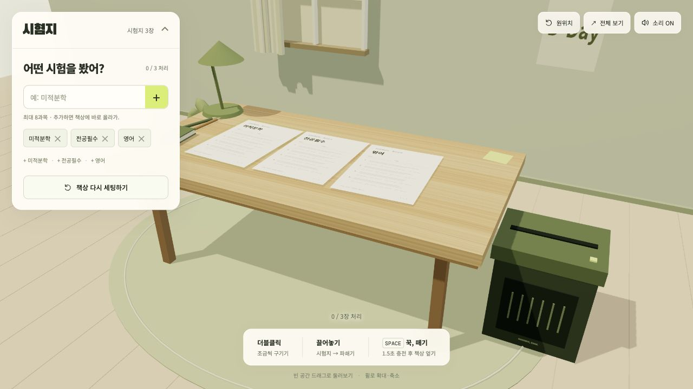

# 시혐지

시험을 치른 과목 이름을 입력하고, 책상 위 시험지를 구기거나 파쇄하고 책상을 엎으며 스트레스를 푸는 3D 브라우저 게임입니다.

## 플레이와 미리보기

**[시혐지 플레이 바로가기](https://kiimyjun.github.io/shitheom/)**



## 조작 방법

왼쪽 위 **시혐지** 패널을 펼쳐 과목을 추가하면 시험지가 책상에 올라옵니다. 한 번에 최대 8과목까지 추가할 수 있습니다.

| 조작 | 동작 |
| --- | --- |
| 시험지 더블클릭 | 한 단계씩 구기기. 총 6번 더블클릭하면 완료됩니다. |
| 시험지를 파쇄기로 끌어놓기 | 자동 파쇄. 투입할 위치가 빛나며, 파쇄기 밖에 놓으면 원래 자리로 돌아옵니다. |
| **Space**를 1.5초 이상 누르고 떼기 | 책상 엎기 |
| 터치 화면의 빈 공간을 1.5초간 누르기 | 충전이 끝나면 바로 책상 엎기 |
| 빈 공간에서 왼쪽 드래그 | 시점 회전 |
| 마우스 휠 | 확대·축소 |
| 가운데 버튼 드래그 | 시점 위치 이동 |
| **원위치 / 전체 보기** | 기본 시점 복귀 / 넓은 시점 전환 |
| **책상 다시 세팅하기** | 같은 과목으로 책상 초기화 |

- PC 키보드·마우스 조작을 우선으로 설계했습니다. 오른쪽 드래그로도 시점을 회전할 수 있습니다.
- 터치에서는 두 번 탭해 구기고, 시험지를 끌어 파쇄할 수 있습니다. 빈 공간 드래그는 시점 회전, 두 손가락 조작은 확대·축소와 이동입니다. 빈 공간을 1.5초간 누르면 책상이 엎어집니다. 손가락을 움직이거나 두 손가락으로 조작하면 충전이 취소됩니다.
- 과목을 추가하거나 삭제하면 책상이 새로 세팅됩니다. 과목 목록과 소리 설정은 현재 브라우저에 저장됩니다.

## 사용 기술

| 기술 | 용도 |
| --- | --- |
| TypeScript | 게임 상태, 입력과 화면 로직 작성 |
| Three.js | 3D 공간, 물체와 카메라 표현 |
| Rapier 3D | 중력, 충돌과 물체의 움직임 계산 |
| Vite | 개발 서버와 배포용 빌드 |
| Canvas 2D / Web Audio | 시험지 인쇄 이미지와 효과음 생성 |

게임은 브라우저에서 실행되며 별도 백엔드 없이 동작합니다.

## 로컬 실행

Node.js **24 이상**과 npm이 필요합니다. 프로젝트 폴더에서 다음 명령을 실행합니다.

```sh
npm ci
npm run dev
```

실행 후 터미널에 표시되는 로컬 주소를 엽니다. 기본 주소는 `http://127.0.0.1:5173/`입니다.

| 명령 | 설명 |
| --- | --- |
| `npm run dev` | 개발 서버 실행 |
| `npm test` | 게임 규칙, 상태 전환과 입력 판정 검사 |
| `npm run build` | TypeScript 검사 후 `dist/`에 배포 파일 생성 |
| `npm run preview` | 빌드한 게임을 로컬에서 확인 |

## 프로젝트 구조

| 경로 | 역할 |
| --- | --- |
| `src/main.ts` | 게임 실행 시작점 |
| `src/game/` | 상태·입력·화면·3D·효과음 연결 |
| `src/domain/` | 과목, 시험지 상태와 게임 규칙 |
| `src/input/` | 클릭, 더블클릭, 드래그, 터치 길게 누르기와 스페이스바 입력 |
| `src/ui/` | 과목 패널, 버튼, 조작 안내와 상태 표시 |
| `src/three/` | 3D 공간, 카메라, 물체와 애니메이션 |
| `src/physics/` | 중력과 충돌 계산 |
| `src/services/` | 브라우저 저장과 효과음 |
| `tests/` | 게임 규칙과 동작 검사 |
| `public/` | 빌드에 포함되는 정적 파일 |
| `docs/` | 구조 설명과 미리보기 이미지 |

카메라·책상·종이 설정은 `src/config.ts`, 화면 스타일은 `src/style.css`에서 조정합니다.
파일별 역할과 수정 위치는 [구조 설명](docs/ARCHITECTURE.md)에 정리했습니다.

## 이용 조건

Copyright (c) 2026 kiimyjun. All rights reserved.
